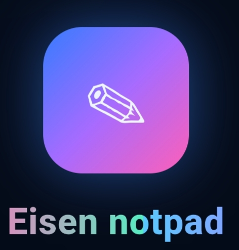

<!DOCTYPE html>
<html lang="ar" dir="rtl">
<head>
<meta charset="UTF-8">
<meta name="viewport" content="width=device-width, initial-scale=1, viewport-fit=cover">
<meta name="theme-color" content="#071225">
<title>Eisen notpad</title>

</head>
<body>

  
  
✎

  
Eisen notpad

كل أفكارك في مكان واحد

  <header class="topbar">

<h1>Eisen notpad</h1>
مساحة أفكارك وملاحظاتك

<button class="primary" id="newBtn">＋ ملاحظة جديدة</button></header>
  <section class="hero"><h2>أفكارك تستحق مكانًا منظّمًا ✨</h2>
دوّن أفكارك، رتّب مهامك، وثبّت الملاحظات المهمة لتصل إليها بسرعة.

<button class="primary" id="heroNew">＋ اكتب ملاحظة</button><button class="secondary" id="exportBtn">⇩ تصدير نسخة احتياطية</button>
</section>
  

<input id="searchInput" type="search" placeholder="ابحث في عنوان الملاحظة أو محتواها..." autocomplete="off">
<button class="iconbtn" id="importBtn">⇧ استيراد</button><input type="file" id="importFile" accept="application/json,.json" hidden>

  <nav class="filters" id="filters"><button class="filter active" data-filter="all">كل الملاحظات</button><button class="filter" data-filter="pinned">📌 المثبّتة</button><button class="filter" data-filter="tasks">☑ المهام</button></nav>
  
<h3 id="listTitle">ملاحظاتك</h3>0 ملاحظة

  <main class="notesgrid" id="notesGrid"></main>

<nav class="bottomnav"><button class="active" data-page="notes">▤الملاحظات</button><button data-page="tasks">☑المهام</button><button data-page="settings">⚙الإعدادات</button></nav>

<h3 id="editorTitle">ملاحظة جديدة</h3><button class="iconbtn" data-close="noteModal">✕</button>
<form id="noteForm"><input id="noteId" type="hidden"><label class="label" for="titleInput">العنوان</label><input class="field" id="titleInput" maxlength="120" placeholder="اكتب عنوان الملاحظة..." required><label class="label" for="contentInput">المحتوى</label><textarea class="field" id="contentInput" placeholder="اكتب أفكارك هنا..." required></textarea>

<label class="label" for="categoryInput">التصنيف</label><select class="field" id="categoryInput"><option value="عام">عام</option><option value="شخصي">شخصي</option><option value="عمل">عمل</option><option value="دراسة">دراسة</option><option value="مهام">مهام</option></select>

<label class="label">لون الملاحظة</label>
<button type="button" class="colorpick selected" data-color="#4285ff" style="background:#4285ff"></button><button type="button" class="colorpick" data-color="#28d7e5" style="background:#28d7e5"></button><button type="button" class="colorpick" data-color="#a66bff" style="background:#a66bff"></button><button type="button" class="colorpick" data-color="#ff5fb7" style="background:#ff5fb7"></button><button type="button" class="colorpick" data-color="#ffd166" style="background:#ffd166"></button>

<label style="display:flex;align-items:center;gap:9px;margin:0 0 16px;color:#b8c9df;font-size:13px"><input type="checkbox" id="taskInput"> هذه الملاحظة مهمة / مهمة يجب إنجازها</label>

<button class="primary" type="submit">حفظ الملاحظة</button><button class="secondary" type="button" data-close="noteModal">إلغاء</button>
<button class="danger" type="button" id="deleteBtn" hidden>حذف</button>
</form>

<h3>الإعدادات</h3><button class="iconbtn" data-close="settingsModal">✕</button>

<strong>عدد الملاحظات</strong><small>المحفوظة على هذا الجهاز</small>
<strong id="settingsCount">0</strong>

<strong>حفظ تلقائي محلي</strong><small>تُحفظ بياناتك في متصفح هذا الجهاز</small>
● مفعّل

<strong>نسخة احتياطية</strong><small>احفظ الملاحظات في ملف JSON أو استعدها</small>

<button class="secondary" id="settingsExport">تصدير</button><button class="secondary" id="settingsImport">استيراد</button>

<button class="danger" id="clearAll">حذف جميع الملاحظات</button>
تنبيه: الملاحظات محفوظة على هذا المتصفح فقط؛ امسح بيانات المتصفح قد يؤدي إلى حذفها. استخدم النسخة الاحتياطية للاحتفاظ بها.

</body>
</html>